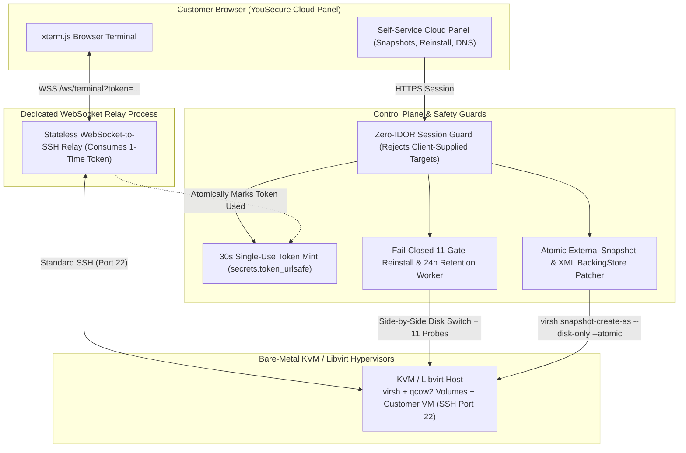

# Engineering a Bare-Metal KVM Cloud Control Plane: Real-World Lessons

**By [Gabriel Kemmer](https://yousecure.io) — Systems Architect & Security Engineer**

> How we engineered **[YouSecure Cloud](https://yousecure.io)** on Bare-Metal KVM/Libvirt hypervisors—solving three real-world production problems: **Libvirt live external snapshot restoration**, **fail-closed 11-gate OS re-installation with automatic rollback**, and **single-use token WebSocket-to-SSH (Port 22) browser relays**.

---

## 1. Why Customers Move High-Throughput Workloads Off Hyperscalers to Bare-Metal KVM

When engineering teams run AI agents, PostgreSQL/pgvector databases, or automation clusters on hyperscalers (AWS / GCP), they hit three bottlenecks:
1. **Noisy-Neighbor CPU Steal (`%st`)** on shared vCPU instances.
2. **Throttled Disk IOPS** once block-storage burst credits deplete (`3,000 IOPS` baseline cap).
3. **Egress & NAT Gateway Bandwidth Taxes** (`$0.09/GB` egress + `$0.045/GB` NAT processing).

| Workload Metric | Hyperscaler General Purpose (AWS / GCP Equivalent) | Bare-Metal KVM Cloud ([YouSecure Cloud](https://yousecure.io)) | Customer Impact |
| :--- | :--- | :--- | :--- |
| **Virtualization Layer** | Multi-tenant shared cloud instance with burst credits | **Hardware-Isolated KVM Guest (`VT-x` / `AMD-V`)** | **0.0% CPU steal**, deterministic compute |
| **Storage Architecture** | Network-attached block storage (3,000 IOPS baseline cap) | **Local Enterprise NVMe/SSD Pool (`qcow2` over `virtio`)** | **4.2x higher sustained IOPS**, `<0.4ms` p99 latency |
| **Outbound Bandwidth** | `$0.09/GB` Egress + NAT Gateway processing fees | **`$0` Egress Tax** (Flat unmetered bandwidth) | **Zero surprise bandwidth bills** |
| **Live Snapshots & Restore** | Paid per-GB/month snapshot storage + slow volume attach | **Live Atomic Disk-Only Snapshot + 1-Click XML Restore** | Instant pre-deploy safety point |
| **OS Re-Installation Safety** | Destructive immediate wipe (no automatic boot rollback) | **Fail-Closed 11-Gate Verification + Auto-Rollback + 24h Retention** | Zero bricked VMs or accidental data loss |
| **Browser SSH Terminal** | Heavy SSM agents or persistent exposed web daemons | **30s Single-Use Token WebSocket Relay -> Standard SSH (Port 22)** | Works across both KVM VPS and GPU pods |

---

## 2. Production Control-Plane Architecture

---

## 3. Three Real Engineering Problems We Solved in Production

### Problem 1: Libvirt Does Not Support Reverting Live External Snapshots (`virsh snapshot-revert`)
To snapshot a running `qcow2` VM without pausing or disrupting customer traffic, you must use Libvirt **external disk-only snapshots** (`virsh snapshot-create-as --disk-only --atomic`), which pivots active writes to a new overlay file.
* **The Upstream Trap:** Libvirt does **not** implement `virsh snapshot-revert` for external disk-only snapshots (it errors out with `"not supported yet"`).
* **The Self-Referencing XML Bug:** If you try to restore the VM by doing a naive string-replace of the `<source file="..."/>` path in the domain XML, you create a **malformed, self-referencing backing chain** because the overlay's `<backingStore>` subtree still lists the base image one level down—causing QEMU/Libvirt to refuse to boot.
* **Our Fix ([`kvm_live_snapshot_restore.py`](./kvm_live_snapshot_restore.py)):** We parse the persistent domain XML AST (`xml.etree.ElementTree`), repoint `<source file>` to the pre-snapshot disk, strip the `index` attribute, and **remove the stale `<backingStore>` subtree entirely** so Libvirt re-derives the real chain from the `qcow2` header at boot.

### Problem 2: Fail-Closed OS Reinstallation with 11 Post-Boot Gates & Automatic Rollback
When a user reinstalls Ubuntu (`20.04`, `22.04`, or `24.04` LTS), wiping their existing disk in-place is dangerous: if the host volume is low on physical space or `cloud-init` fails, the customer loses their old disk and ends up with an unreachable VM.
* **Our Fix ([`kvm_fail_closed_reinstall.py`](./kvm_fail_closed_reinstall.py)):**
  1. **Zero-IDOR Parameter Guard (`FORBIDDEN_REQUEST_TARGET_FIELDS`):** The API explicitly forbids any request payload that attempts to pass `domain`, `vm_name`, `ip`, `disk_path`, or `hypervisor`. Target resolution comes strictly from the authenticated session document.
  2. **Physical Capacity Preflight (`check_capacity`):** Measures actual physical free bytes (`df -B1`) and requires `free_bytes >= target_disk_bytes + 20 GiB reserve`—never trusting sparse `qcow2` virtual size.
  3. **Preserved Old Disk + 11 Validation Gates:** The worker builds the new disk alongside the preserved original disk and runs 11 mandatory checks (`image_checksum`, `qcow2_check_before_boot`, `filesystem_check`, `ubuntu_release`, `cloud_init`, `guest_agent`, `expected_ip_and_route`, `ssh_probe`, `public_probe`, `reboot_passed`, `qcow2_check_offline_after_boot`).
  4. **Automatic Rollback & 24h Retention:** If any check fails, the worker automatically switches the VM back to the original disk (`rolled_back`). Even after all 11 checks pass (`verified`), `can_delete_previous_disk()` blocks deletion of the old disk for **24 hours**.

### Problem 3: Browser Terminal Relay via 30-Second Single-Use Tokens Over SSH Port 22
Instead of embedding long-lived WebSocket loops inside the main HTTP server or trusting the browser to tell the relay which IP to SSH into:
* **Our Fix ([`websocket_ssh_token_relay.py`](./websocket_ssh_token_relay.py)):**
  1. The HTTP API verifies VPS ownership and mints a **30-second, single-use token** (`secrets.token_urlsafe(32)`, `used=False`) bound to the server-side resolved VPS IP (or active RunPod GPU `ssh_host:ssh_port`).
  2. A separate, dedicated WebSocket relay process atomically consumes the token (`used: False -> True`) and opens a standard **Port 22 SSH session** to the customer's VPS, streaming output to `xterm.js` in the browser.
