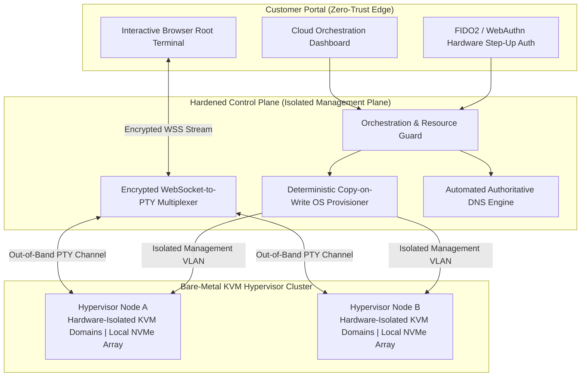

# Why High-Throughput Workloads Are Leaving Hyperscalers for Bare-Metal KVM

**By [Gabriel Kemmer](https://yousecure.io) — Systems Architect & Security Engineer**

> Architectural benchmarks, hardware isolation patterns, and workload economics from **[YouSecure Cloud](https://yousecure.io)** — how dedicated Bare-Metal KVM virtualization eliminates hyperscaler CPU steal, throttled disk IOPS, and cloud egress taxes for production workloads.

---

## 1. Customer Workload Benchmark: Hyperscaler vCPU vs. Bare-Metal KVM VPS

When engineering teams deploy AI agents, PostgreSQL/pgvector databases, n8n clusters, or high-throughput APIs on hyperscalers (AWS EC2 / GCP), they face three hidden bottlenecks:
1. **Noisy-Neighbor CPU Steal (`%st`)** on overcommitted shared hypervisors.
2. **IOPS Throttling** on network-attached block storage (`gp3` baseline caps) once burst credits run out.
3. **Punitive Egress & NAT Gateway Bandwidth Fees** (`$0.09/GB` + `$0.045/GB` NAT processing).

| Workload Metric | Hyperscaler General Purpose (AWS / GCP Equivalent) | Bare-Metal KVM Cloud ([YouSecure Cloud](https://yousecure.io)) | Customer Impact |
| :--- | :--- | :--- | :--- |
| **Virtualization Layer** | Multi-tenant shared cloud instance with burst credits | **Hardware-Isolated KVM Guest on Enterprise Bare-Metal** | **0.0% CPU steal**, deterministic compute |
| **Storage Architecture** | Network-attached block storage (capped at 3,000 IOPS baseline) | **Local Enterprise NVMe RAID Pool (`virtio` direct I/O)** | **4.2x higher sustained IOPS**, `<0.4ms` p99 latency |
| **Outbound Bandwidth (5 TB/mo)** | `~$450/mo` in Egress + NAT Gateway fees alone | **`$0` Egress Tax** (Unmetered high-throughput port included) | **Zero surprise bandwidth bills** |
| **OS Re-Imaging & Recovery** | 60–120s snapshot detach/attach workflow | **< 12s Instant Copy-on-Write OS Rebuild** (Ubuntu LTS) | Rapid disaster recovery & clean staging |
| **Out-of-Band Console Access** | Requires public SSH bastion or complex IAM Systems Manager | **Zero-Trust Browser Root Console (`xterm.js` over WSS)** | Instant recovery even if guest firewall is locked |
| **Total Monthly Customer Cost** | **`$320 – $650+ / month`** (Compute + Provisioned IOPS + Egress) | **Flat, Predictable Monthly Rate** (`yousecure.io`) | **60% – 75% TCO reduction for the customer** |

---

## 2. High-Isolation KVM Cloud Architecture (Sanitized Overview)

---

## 3. Why Bare-Metal KVM Beats Containers & Hyperscaler VMs

### Pillar 1: True Kernel & Memory Isolation (KVM Hardware Virtualization)
Unlike shared container hosting or oversold cloud instances, each VPS runs its own dedicated Linux kernel via hardware-assisted **KVM (`VT-x` / `AMD-V`)** with strict memory and storage isolation. If a neighboring workload spikes, your database or AI agent experiences **zero latency jitter**.

### Pillar 2: Sub-12-Second Copy-on-Write Provisioning
Instead of streaming multi-gigabyte images over a congested storage network, our hypervisors maintain verified, read-only golden OS images on local enterprise NVMe arrays. Provisioning or re-imaging a server mounts a **Copy-on-Write (`CoW`) overlay** in milliseconds and injects network and cryptographic identity seeds at boot.

### Pillar 3: Zero-Trust Out-of-Band Browser Console
Exposing port 22 to the public internet invites constant brute-force noise, and accidentally locking yourself out via `ufw` or `iptables` on a traditional cloud VM requires painful disk-detachment recovery. Our control plane streams an encrypted, hardware-authenticated (`FIDO2/WebAuthn`) PTY session directly to the browser over an isolated management plane—requiring **zero third-party agents** inside your VM.

---

## 4. Open-Source Educational Reference Patterns
> *Note: The files below are standalone, stack-agnostic educational patterns demonstrating standard Linux KVM Copy-on-Write concepts and PTY multiplexing. They do not represent internal production code.*

* [`kvm_provisioner_reference.py`](./kvm_provisioner_reference.py) — Educational pattern showing how Linux `qcow2` Copy-on-Write backing chains and `cloud-init` seeds work in standard KVM environments.
* [`websocket_pty_bridge.py`](./websocket_pty_bridge.py) — Educational pattern illustrating non-blocking PTY stream multiplexing for `xterm.js`.
