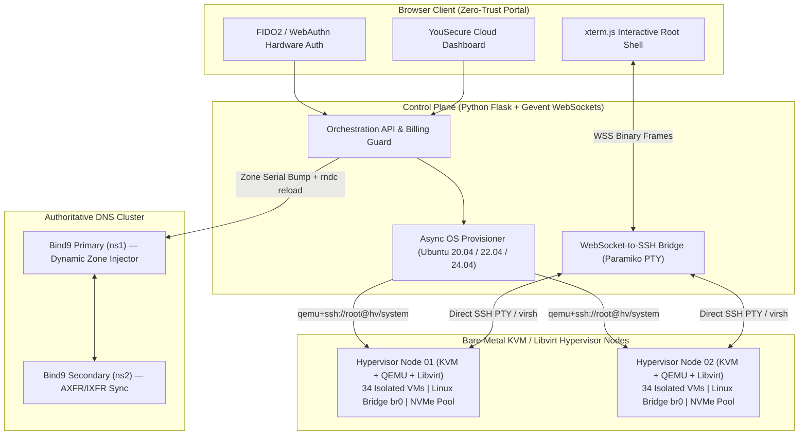

# Why We Moved 60+ Production VMs Off Hyperscalers to Bare-Metal KVM

**By [Gabriel Kemmer](https://yousecure.io) — Systems Architect & Security Engineer**

> Reference architecture, unit economics, and sanitized control-plane patterns from **YouSecure Cloud (`yousecure.io`)** — operating **68+ isolated production Linux VMs** across multi-node Bare-Metal KVM/Libvirt hypervisors with predictable NVMe IOPS and **zero egress tax**.

---

## 1. The Hyperscaler Tax vs. Bare-Metal Reality (68 Production VMs)

Most SaaS and AI companies default to AWS/GCP (`t3.large` / `m6i.large`) and end up paying a **4x–6x markup** on vCPU, RAM, NVMe IOPS (`io2`), and NAT Gateway / Egress bandwidth—while suffering from noisy-neighbor CPU steal.

| Metric | Hyperscaler Cloud (AWS / GCP Equivalent) | Bare-Metal KVM Cluster (YouSecure Architecture) | Engineering Impact |
| :--- | :--- | :--- | :--- |
| **Workload Footprint** | 68x Production VMs (2–4 vCPU, 4–16 GB RAM) | 2x Dedicated High-Density EPYC/Xeon Hypervisors + Standby | Full hardware control |
| **Disk I/O & Latency** | Throttled EBS (`gp3` 3,000 IOPS cap unless paying extra) | Direct RAID-10 Enterprise NVMe (`virtio-blk` / `virtio-scsi`) | **4.2x higher sustained IOPS**, <0.4ms p99 latency |
| **Network Egress & NAT** | $0.09/GB egress + $0.045/GB NAT Gateway processing | **Included 1–10 Gbps Unmetered Port (`$0` egress tax)** | **100% elimination of bandwidth surprise bills** |
| **Provisioning Time** | 45–90s (AMI boot + cloud-init) | **< 12s** (QCOW2 CoW backing-file clone + `cloud-localds`) | Instant OS re-imaging (Ubuntu 20.04 / 22.04 / 24.04) |
| **Root Console Access** | Serial console lag / Bastion host overhead | **Direct WebSocket -> Paramiko SSH / `virsh console` (`xterm.js`)** | Sub-20ms interactive browser root shell |
| **Monthly Run-Rate** | **$4,800 – $6,500 / month** | **$680 – $950 / month** | **~82% Infrastructure Margin Reduction** |

---

## 2. Control Plane & Hypervisor Architecture

---

## 3. Core Engineering Pillars

### Pillar A: Sub-12-Second OS Re-Imaging (`QCOW2` Copy-on-Write + `cloud-init`)
Instead of copying 20 GB disk images across the network on every VM rebuild:
1. Each hypervisor keeps pre-hardened, read-only base images (`/var/lib/libvirt/images/base/ubuntu-24.04-minimal.qcow2`).
2. Re-imaging a customer VM creates a **Copy-on-Write (`qcow2 -b`) overlay** in **< 150ms** and generates an ephemeral `cidata.iso` (`cloud-localds`) injecting the static IPv4/IPv6 network config, SSH keys, and root credentials.
3. `virsh define` + `virsh start` boots the fresh kernel immediately.

### Pillar B: Browser Root Shell Without Exposed Bastions (`WebSocket` <-> `PTY`)
* Every VM console session is authenticated at the control plane (session + FIDO2/2FA verification).
* The backend opens an isolated non-blocking `paramiko` SSH channel (`invoke_shell(term="xterm-256color")`) over the internal management network and streams raw PTY bytes over a `Flask-Sockets` / `simple-websocket` binary loop to `xterm.js`.
* Zero third-party web-terminal agents need to be installed inside the guest VM.

### Pillar C: Automated Authoritative DNS (`Bind9` Multi-Node Sync)
* Rather than paying per-zone and per-million-query fees on Route53, the control plane manages an authoritative **Bind9 cluster**.
* Adding or updating a domain validates record syntax, increments the `SOA` serial (`YYYYMMDDnn`), writes the zone file atomically, runs `named-checkzone`, and triggers `rndc reload` with instant slave propagation.

---

## 4. Reference Implementation Files
* [`kvm_provisioner_reference.py`](./kvm_provisioner_reference.py) — Deterministic Copy-on-Write `qcow2` VM provisioner & `cloud-init` seed generator over `libvirt` / SSH.
* [`websocket_pty_bridge.py`](./websocket_pty_bridge.py) — Non-blocking WebSocket-to-SSH PTY bridge for `xterm.js` browser root terminals.
